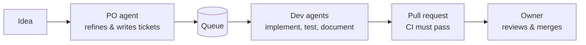

# Super Dev House

A software house made of **one human and a team of Claude agents**, built in the open as a portfolio project.

The idea is simple: an AI agent works best, and costs least, with a **short, focused context**. So here nobody carries a long conversation around. Every rule, decision and task lives on GitHub. A fresh agent starts with an empty context, reads its role, picks up one ticket, fetches only the context that ticket needs, and gets to work. When its context fills up, the session is simply replaced. Because sessions stay small, the whole team runs on a regular Claude subscription instead of per-token billing.

## How work flows

1. The **owner** brings an idea. The **PO agent** interviews them and turns it into small, well-specified tickets.
2. A ticket in the `Queue` is an approved specification. A **development agent** claims it, works on a branch, writes the tests and docs, and opens a pull request.
3. The agent waits for CI and fixes its own failures.
4. The **owner** reviews and merges. Agents never merge.

## The team

| Role | What it does |
|---|---|
| Owner (human) | Sets direction, reviews, tests and merges every pull request. |
| PO agent | Discovery, scope and tickets. |
| Development agents | Implement one ticket at a time, with tests and documentation. |
| Design agent *(planned)* | UI/UX with the owner; leaves implementation-ready design docs and tickets. |

## Principles

- **GitHub is the memory.** Rules, decisions and progress are written down; sessions are disposable.
- **Small contexts, low cost.** Agents load only what the task needs.
- **Agents never merge** and never push to `main`. A human always has the last word.
- **Everything is tested and documented**, including end-to-end tests.
- **English on GitHub**, private by default, no secrets anywhere.

## What's next

The first project built by the house is its own website: a portfolio and blog showing how the agents work, built with [Astro](https://astro.build).

The process lives in the (currently private) `handbook` repository; parts of it will be published as the house grows.
